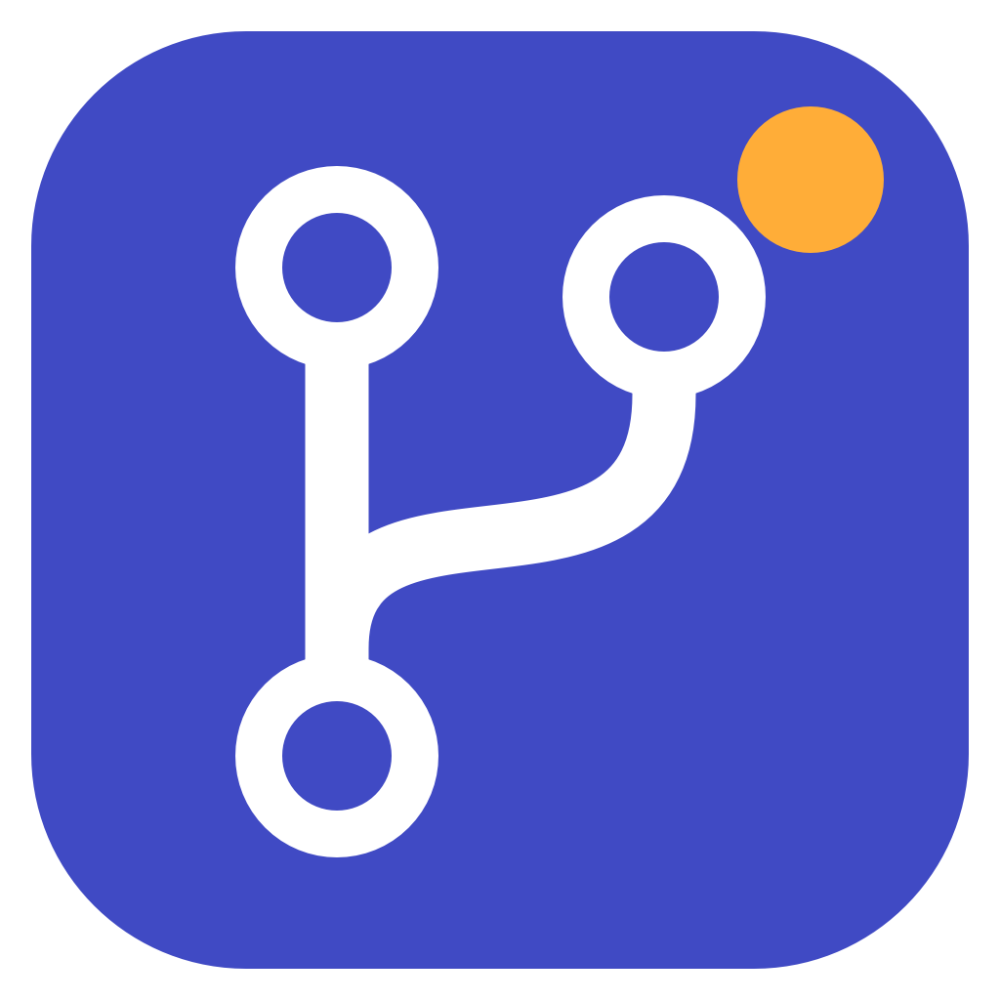

# GHNotif



**English** | [Polski](README.pl.md)

A macOS menu bar / Windows system tray app that shows open pull requests (drafts optional) from the people you follow, across every repository your GitHub token can see. Each platform has its own native UI.

## Installing on macOS

**Homebrew (recommended):**

```bash
brew tap MichalFidor/ghnotif
brew install --cask ghnotif
# update:
brew upgrade --cask ghnotif
```

Prebuilt packages for Apple Silicon and Intel are also available in [GitHub Releases](https://github.com/MichalFidor/GHNotif/releases/latest).
Unzip and move `GHNotif.app` to Applications. Swift is not required.
The Homebrew packages are not notarized or signed with a developer certificate either, so macOS may block
the first launch. After verifying the source and the SHA-256 checksum, use
System Settings → Privacy & Security → Open Anyway.

Building from source:

```bash
./scripts/build-app.sh            # builds build/GHNotif.app
./scripts/build-app.sh --install  # copies it to ~/Applications and launches it
```

Requires macOS 15+ and Swift 6 (Command Line Tools are enough). Launch at login can be enabled in GHNotif → Settings → General.

On first launch, sign in with `gh auth login` or save a read-only PAT (see [Authentication](#authentication)), then add people in the settings.

## Installing on Windows

Requires Windows 10/11. The portable build bundles .NET, so nothing else needs to be installed.

1. Download `GHNotif-win-x64.zip` (typical PC) or `GHNotif-win-arm64.zip` from [GitHub Releases](https://github.com/MichalFidor/GHNotif/releases/latest).
2. Extract the whole ZIP to a permanent folder and run `GHNotif.Windows.exe`; keep `GHNotif.ico` next to it.
3. Click the icon next to the clock (it may be hidden under the arrow). Right-click for settings, refresh or quit.
4. Sign in with `gh auth login` or save a read-only PAT (see [Authentication](#authentication)), then add people in the settings.

The app is not signed with a publisher certificate, so Windows SmartScreen may show a warning. Only run builds from a trusted source.
Closing the panel hides it to the tray. Launch at login can be enabled in the app settings.

Building on Windows (requires the .NET 10 SDK):

```powershell
./scripts/build-windows.ps1                    # build/GHNotif-win-x64.zip
./scripts/build-windows.ps1 -Runtime win-arm64 # build/GHNotif-win-arm64.zip
```

The Windows version has a light panel grouped by repository, with avatars, review and CI state, tooltips, local dismissing and tray notifications (their visibility depends on Windows settings). The PR count is shown in the panel and in the tray icon tooltip. The macOS UI follows the system appearance.

## Authentication

GHNotif only sees PRs from repositories its token can access. If the list shows only PRs from public repositories (e.g. you follow a dozen people and see one PR), the token lacks access to private repositories (`repo` for a classic PAT, **All repositories** + **Pull requests: read** for a fine-grained one) or isn't authorized for an SSO organization. Pick one of the two options; Settings → Token describes them too. Then click **Check connection** (Settings → Get started or Token) - it shows the token's scopes and, for each of your organizations, whether the token can access it (SSO, blocked PATs) with an **Authorize SSO** link.

### Option 1: GitHub CLI (simplest)

No token to create or paste - the app runs `gh auth token`.

1. Install GitHub CLI: `brew install gh` (macOS) or `winget install GitHub.cli` (Windows).
2. Run `gh auth login`, choose GitHub.com and sign in with the browser. Authorize SSO organizations if GitHub asks.
3. If a PAT is saved in GHNotif, remove it (Settings → Token → Remove PAT and use gh CLI) - a PAT takes precedence over `gh`.

The `gh` token is broad: by default it has `repo`, `read:org` and `gist`, including write access, and other tools on your machine use it too. If you want GHNotif to have the minimum access, use a read-only fine-grained PAT (option 2).

On macOS the app looks for `gh` in `/opt/homebrew/bin`, `/usr/local/bin` and `/usr/bin`. On Windows it looks in the standard install folders (`Program Files\GitHub CLI`, scoop) and in absolute `PATH` entries; restart GHNotif after installing it.

### Option 2: personal access token (PAT)

GHNotif only reads data, so the token doesn't need any write access.

- **Fine-grained PAT, read-only (most secure)** - [create one with the permissions preselected](https://github.com/settings/personal-access-tokens/new?name=GHNotif&description=Read-only+access+for+GHNotif&pull_requests=read&statuses=read&expires_in=90):
  - Resource owner - the organization with the PRs,
  - Repository access - **All repositories**,
  - Repository permissions - **Pull requests: read** (required) and **Commit statuses: read** (CI state); Metadata: read is added automatically,
  - Organization permissions - **Members: read**, optional, only for team import; add it by hand after choosing the organization.

  Limitations: one token covers one resource owner, so PRs from other organizations won't be visible, and the organization may require an admin to approve the token. CI state may be incomplete, because fine-grained tokens can't read GitHub Actions check runs.
- **Classic PAT** - when you need several organizations in one token ([create one with `repo` preselected](https://github.com/settings/tokens/new?scopes=repo&description=GHNotif)):
  - `repo` - required for PRs from private repositories. GitHub has no read-only scope for private repositories, so `repo` also grants write access.
  - `read:org` - optional, only for team import and the organization list in **Check connection**.

  Other scopes (e.g. `project`, `read:packages`) don't grant access to PRs, and **Check connection** flags scopes GHNotif doesn't need.
- Organizations with SAML SSO: on the tokens page click **Configure SSO → Authorize** next to the token. Otherwise GitHub hides their PRs; the app then shows a warning with a link to authorize the token.
- Set an expiration date and create the token only for GHNotif, so you can revoke it without affecting other tools.

Save the PAT in Settings → Token. On macOS it is stored in the Keychain; on Windows it is encrypted with DPAPI for the current user and never written to the JSON config. A saved PAT takes precedence over `gh`. Each PAT is bound to the GitHub server it was saved for - after changing the server, save a PAT created on the new one.

### Only PRs from your own repositories are visible

If the token already has `repo` but PRs from organization repositories are still missing:

1. **SAML SSO** - on [github.com/settings/tokens](https://github.com/settings/tokens) click **Configure SSO → Authorize** next to the token for that organization. With `gh`, run `gh auth refresh` and authorize the organization in the browser.
2. **Organization token policy** - an organization can block classic PATs or require approval of fine-grained PATs. GitHub then hides its PRs without any warning. Use `gh` or ask an organization admin.
3. **OAuth app restrictions** - with `gh`, the organization must allow the GitHub CLI app. If it doesn't, request access on the authorization page or ask an admin.

**Check connection** in settings points out which organization is the problem. You can also open `https://github.com/pulls?q=is:pr+is:open+author:LOGIN` in the browser (it uses your browser session, not the token). If the PRs appear there but not in GHNotif, the problem is the token's access to the organization.

## Configuration

Settings (the gear icon in the panel header) have a sidebar on the left (like System Settings) and show the selected section on the right:

- **Get started** - opens on first launch and when nobody is watched yet: a checklist (token, people, optional search and notification settings) with shortcuts to each section and **Check connection**.
- **People** - add people to follow (logins are verified on GitHub); the list is collapsed by default, with a counter and a filter. You can import/export the list as JSON or import members of a GitHub team (requires organization membership access: `read:org` for classic tokens or `Members: read` for fine-grained ones).
- **Search** - mentions and review requests (see below), drafts, hiding approved PRs, extra qualifiers (e.g. `org:my-org`) and excluded repositories and labels.
- **Reminders** - days and times of the review reminder window (see below).
- **Notifications** - notifications on/off, which events notify, quiet hours (see below).
- **General** - language, refresh interval, highlighting PRs open for N days (7 by default, 0 = off), sorting, auto-dismiss after your own review, launch at login, version and updates.
- **Token** - current token source, **Check connection**, setup steps for GitHub CLI and a PAT (read-only fine-grained or classic `repo`), saving or removing a PAT and the GitHub server host (see below).

A new installation starts with an empty list of people; the empty PR list has a **Set up** button that opens Get started.

## GitHub Enterprise

By default GHNotif uses github.com. If your company uses GitHub Enterprise Server or GHE.com, enter its host (e.g. `github.company.com`) in **Settings → Token → GitHub server** and click **Apply**. The app then uses that server's API, `gh auth token --hostname HOST` (sign in with `gh auth login --hostname HOST`) and links to that server for PATs and SSO. Only a plain host name is accepted (no port, login or special characters), and the token is sent only to that server - enter a trusted company address only. Update checks still use github.com.

## Mentions and review requests

PRs from the people you follow come first, but the list can also include:

- **mentions** (`mentions:@me`, on by default) - open PRs by any author where someone mentioned you; marked with a purple `@`,
- **review requests** (`user-review-requested:@me`, off by default) - requests addressed to you personally; marked with a person icon with a question mark,
- **team review requests** (`review-requested:@me`, off by default, available with review requests on) - also requests sent to your teams, e.g. when someone adds the whole QA team as a reviewer; marked with a team icon when only the team was asked.

Under **Visibility** you can also **show drafts** (marked with a Draft label; hidden by default) and **hide approved PRs** (review decision "Approved" on GitHub). PRs open for at least the number of days set in General show their age in orange with a clock icon.

Mentions include PRs by any author (including your own). Extra scope qualifiers apply to both searches. When you turn an option on, existing PRs don't trigger notifications - only new ones do.

The configuration is stored in `~/Library/Application Support/GHNotif/config.json`.
On Windows: `%LOCALAPPDATA%/GHNotif/config.json`; dismissed, snoozed and seen PRs and collapsed repositories are kept in `state.json`, and the encrypted PAT in `token.dat`. Don't add these files to a repository and don't share your token.
Settings are independent per platform and are not synchronized.

## Dismissed PRs

The check mark button on the right of a PR marks it as done. The PR disappears from the needs-attention list and the counter. It doesn't come back after a refresh or restart, but it **returns automatically (with a notification) when there is new activity**:

- a new commit (HEAD change, including force-pushes),
- a new comment or review from someone other than you (bot comments are ignored).

Changes to the title, labels or the CI status alone don't bring a PR back.

A notification also appears for new activity on a PR that is already on the list and says who did what, e.g. `✓ anna - approved`, `piotr - changes requested`, `bob - comment` or `dave - pushed commits`. The same event is not repeated on later refreshes. For commits the author of the latest commit is shown (the GitHub API doesn't say who pushed). New PRs are described as "New PR by …", "Your review was requested" or "You were mentioned".

Optionally a PR is dismissed automatically after you submit a review of its current commit, as long as nobody else has been active on it since. A new commit or another person's comment/review brings it back. Later refreshes without changes don't repeat the notification about the same comment. This can be turned off in the settings.

## Unread changes in the PR list

On macOS, a green GitHub approval badge appears beside the menu bar icon when there are no PRs needing attention. It is not shown before the first successful refresh, without a configured search, on errors, or when SSO hides some results. Dismissed and snoozed PRs do not count as needing attention.

The panel shows **Since last read** below each changed PR, with the people who commented, reviewed or authored new commits. New PRs are marked **New PR**. Repeated actions by the same person are grouped by type; this is a summary, not a full activity history.

Opening a PR in the browser marks its current changes as read. You can also use **Mark as read** beside a PR, or **Mark all as read** in the header. Merely opening or closing the panel does not clear anything. Reading a PR does not mark it as done or change anything on GitHub.

Read status survives restarts and works independently of desktop notification filters and quiet hours, even when notifications are disabled. The first successful refresh after enabling this feature establishes a baseline without marking existing PRs as new. Changes are detected during refreshes, not in real time.

## Snoozing and sorting

The clock next to a PR snoozes it for 2 hours or until tomorrow morning. Snoozed PRs are listed separately and come back when the time is up (with a notification if notifications are enabled). Repositories can be excluded as `owner/repo`, labels by name. Sorting: recently updated, oldest first or largest changes. Each PR also shows added/removed lines, CI status and the review decision.

Importing/exporting the watch list transfers logins only - never tokens or private settings. Importing team members uses the GitHub endpoint for reading organization members.

The check mark button in the header switches to the list of dismissed, still open PRs. The arrow next to a PR restores it to the main list. This is purely local app state, not a review or closing the PR on GitHub. IDs together with the dismissal time and the latest commit are kept in macOS preferences or the Windows state file, outside the repository.

## Repository groups

Clicking a repository header collapses or expands its PRs. The number on the right is the PR count in that group (on the main list: those needing attention). The collapsed state is remembered across launches. When collapsed, the panel shrinks and stays attached to the menu bar on macOS or to the tray on Windows.

## Review reminders

In the **Reminders** settings section you can schedule a window that appears in the center of the screen at fixed times, e.g. every weekday at 9:00. It shows the current list of PRs needing attention (grouped by repository) and appears even when the list is empty.

- Choose the weekdays and any number of times per day.
- Each time has its own switch, like an iOS alarm: turn it off without deleting it. A newly added time is switched on.
- **Remind me in 15 min** snoozes the window; **Done** closes it until the next time.
- If the computer was asleep or the app wasn't running, a missed reminder from the same day appears after wake or launch (several missed ones are merged into one).
- Changing the schedule doesn't immediately trigger times that have already passed.

## Language

The UI is available in English and Polish. In **Settings → General → Language** choose *System* (Polish when Polish is the first preferred system language, English otherwise), *Polski* or *English*. New installations follow the system language; existing configurations without this setting stay in Polish.

## Icons and tooltips

Hover over an icon to see what it means. A purple `@` marks a mention, a person icon with a question mark a review request for you, a team icon a review request for your team only. A grey Draft label marks a draft and an orange age with a clock a PR open for longer than the configured number of days. A green check mark means an approved review, a speech bubble/exclamation mark requested changes, an eye a required review. CI dot: green = success, red = failure, yellow = in progress. The separate check mark at the end of a row marks the PR as locally done.

The logo shows a PR branch with a notification dot. The colored app icons (`.icns`/`.ico`), the menu bar logo and its monochrome variant are generated from a shared source:

```bash
swift scripts/generate-icons.swift # macOS
```

## Notifications

Each line says who did what, with a simple text symbol (the GitHub icon of the most important event is shown as the notification badge): ✓ approved, ✗ changes requested, • comment,
↑ new commits, ◉ review requested, @ mention, ⊘ review dismissed, + new PR, ◷ snooze ended.
Notifications also show a GitHub timeline badge for the most important event: on macOS as an attachment
(notifications are grouped per PR), on Windows as a toast icon (clicking the toast opens the PR; the tray balloon
is a fallback). Badges use [Octicons](https://github.com/primer/octicons) (MIT, © GitHub Inc.,
see `Sources/GHNotif/Resources/Octicons-LICENSE.txt`); regenerate them with
`swift scripts/generate-notification-badges.swift`.

In Settings → Notifications you can turn off single events (e.g. comments) and set **quiet hours**
(e.g. 18:00-08:00, may span midnight). Muted events and anything during quiet hours are not sent - not even
later - but the PR list keeps updating.

## macOS notifications

In Settings → Notifications choose **Send test**. The app asks for permission and shows the result and the alert state.
The API accepting a notification doesn't guarantee a banner: in System Settings → Notifications → GHNotif
enable banners/sound and check Focus mode. Automated tests verify that a new PR and a returning dismissed PR
trigger a notification; the look of the system banner has to be checked on a logged-in Mac.

## Releases and updates

The version number comes from `VERSION`. Both apps check for the latest stable release
at launch and every 6 hours; you can also use **Check for updates** in the settings.
When a newer version exists, the app shows a panel banner and sends one system notification
per version (macOS requires GHNotif notification permission). Choose **Update now** or **Later**;
the panel also has an **Update now** button.
The check uses the public API, without a token and without sending your watch list.
Update check errors are shown in the settings and don't interrupt fetching PRs.

macOS Homebrew installations run `brew update` and `brew upgrade --cask ghnotif` in Terminal.
Other macOS installations download the matching ZIP, verify its SHA-256 checksum, replace the
app bundle and relaunch. Windows downloads and verifies the matching ZIP, replaces the app files
after exit, and restarts GHNotif. Installations in protected folders may still need a manual
update with administrator permissions. Settings, tokens and local state stay outside the package.

Publishing: update `VERSION` and `RELEASE-NOTES.md`, push the commit and a `vX.Y.Z` tag
matching `VERSION`. The **Release** workflow runs the macOS/Windows tests, builds four
packages (macOS arm64/x86_64, Windows x64/arm64) and only then publishes the release
with `SHA256SUMS` checksums. The macOS build itself is ad-hoc signed, without notarization.
The workflow also attaches the `ghnotif.rb` cask to the release. Syncing the tap automatically
on later releases requires the repository variable `HOMEBREW_TAP_ENABLED=true` and the secret
`HOMEBREW_TAP_TOKEN` with write access to `MichalFidor/homebrew-ghnotif`.

Publishing runs in the `release` environment, which requires approval from the repository owner
(Actions → waiting run → **Review deployments**). The `main` branch and `v*` tags are
protected by rulesets. Only a repository administrator can bypass them.

## How it works

Instead of one query joined with `OR` (GitHub search allows at most 5 logical operators), authors are split into batches of 10; repeated `author:` qualifiers act as OR. Each batch is a GraphQL query `is:pr is:open draft:false author:… author:…` (without `draft:false` when drafts are on), and the results are merged and deduplicated. Mentions, review requests and team review requests are separate queries; a PR found by several of them carries all their markers.

In the macOS menu bar the logo and the counter are drawn as a single image, because a `MenuBarExtra` label made of several views only shows some of them.

## Tests

```bash
swift run CoreChecks
bash scripts/check-app.sh
```

The tests are a plain executable, because Command Line Tools include neither XCTest nor the Swift Testing macros.
The app tests cover dismissing, restoring, PRs returning after new activity, migrating old state, collapsing repositories, state persistence and notifications. They run with an isolated configuration and fake GitHub and notification services.

Windows:

```powershell
dotnet run --project windows/GHNotif.Checks -c Release
dotnet run --project windows/GHNotif.Windows.Checks -c Release # Windows only
```

The core tests also run on macOS/Linux: queries, pagination, SSO, API errors, configuration, dismissal persistence, returning after new activity, state migration, restoring and notifications. The Windows tests additionally check the WPF layout, dismiss/restore/collapse clicks, settings and DPAPI encryption, without real tokens or accounts.
The Windows workflow builds both portable variants and runs these tests on a Windows runner. A cross-build on a Mac doesn't replace testing the UI on Windows.
