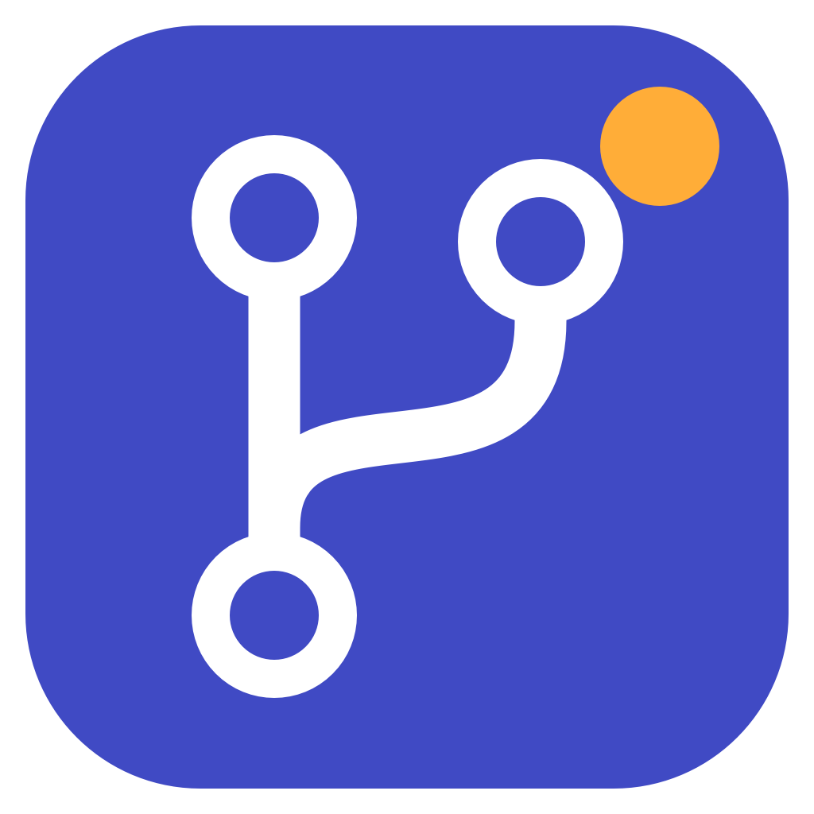

# GHNotif



[English](README.md) | **Polski**

Aplikacja w pasku menu macOS lub zasobniku systemowym Windows, która pokazuje otwarte PR-y wybranych osób (drafty opcjonalnie) ze wszystkich repozytoriów widocznych dla Twojego tokenu GitHub. Obie wersje mają osobny, natywny interfejs.

## Instalacja macOS

**Homebrew (zalecane):**

```bash
brew tap MichalFidor/ghnotif
brew install --cask ghnotif
# aktualizacja:
brew upgrade --cask ghnotif
```

Gotowe paczki dla Apple Silicon i Intela są też w [GitHub Releases](https://github.com/MichalFidor/GHNotif/releases/latest).
Rozpakuj ZIP i przenieś `GHNotif.app` do Applications. Nie wymaga to instalacji Swifta.
Paczki Homebrew również nie są notaryzowane ani podpisane certyfikatem wydawcy - macOS może je zablokować
przy pierwszym uruchomieniu. Po zweryfikowaniu źródła i sumy SHA-256 użyj
Ustawienia systemowe → Prywatność i ochrona → Otwórz mimo to.

Budowanie ze źródeł:

```bash
./scripts/build-app.sh            # buduje build/GHNotif.app
./scripts/build-app.sh --install  # kopiuje do ~/Applications i uruchamia
```

Wymaga macOS 15+ i Swift 6 (wystarczą Command Line Tools). Autostart można włączyć w GHNotif → Ustawienia → Ogólne.

Przy pierwszym uruchomieniu zaloguj się przez `gh auth login` albo zapisz PAT tylko do odczytu (patrz [Autoryzacja](#autoryzacja)), a potem dodaj osoby w ustawieniach.

## Instalacja Windows

Wymaga Windows 10/11. Wersja portable zawiera .NET - użytkownik nie musi go instalować.

1. Pobierz ZIP `GHNotif-win-x64.zip` (typowy komputer) lub `GHNotif-win-arm64.zip` z [GitHub Releases](https://github.com/MichalFidor/GHNotif/releases/latest).
2. Rozpakuj cały ZIP do stałego folderu. Uruchom `GHNotif.Windows.exe`; plik `GHNotif.ico` musi pozostać obok.
3. Kliknij ikonę przy zegarku (może być schowana pod strzałką). Prawy przycisk: ustawienia, odświeżanie lub zakończenie.
4. Zaloguj się przez `gh auth login` albo zapisz PAT tylko do odczytu (patrz [Autoryzacja](#autoryzacja)), a potem dodaj osoby w ustawieniach.

Aplikacja nie jest podpisana certyfikatem wydawcy; Windows SmartScreen może pokazać ostrzeżenie. Uruchamiaj wyłącznie buildy z zaufanego źródła.
Zamknięcie panelu ukrywa go w zasobniku. Autostart można włączyć w ustawieniach aplikacji.

Budowanie na Windowsie (wymagany .NET 10 SDK):

```powershell
./scripts/build-windows.ps1                    # build/GHNotif-win-x64.zip
./scripts/build-windows.ps1 -Runtime win-arm64 # build/GHNotif-win-arm64.zip
```

Wersja Windows ma jasny panel z grupowaniem po repo, awatarami, stanem review i CI, tooltipami, lokalnym odhaczaniem oraz powiadomieniami z zasobnika (ich widoczność zależy od ustawień Windows). Liczbę PR-ów widać w panelu i tooltipie ikony przy zegarku. Interfejs macOS korzysta z motywu systemowego.

## Autoryzacja

GHNotif widzi tylko PR-y z repozytoriów dostępnych dla tokenu. Jeśli lista pokazuje tylko PR-y z publicznych repozytoriów (np. obserwujesz kilkanaście osób, a widzisz jeden PR), token nie ma dostępu do prywatnych repozytoriów (`repo` dla classic PAT, **All repositories** + **Pull requests: read** dla fine-grained) albo nie jest autoryzowany dla organizacji z SSO. Wybierz jedną z dwóch opcji; opisuje je też zakładka Ustawienia → Token. Potem kliknij **Sprawdź połączenie** (Ustawienia → Pierwsze kroki lub Token) - pokaże uprawnienia tokenu oraz dla każdej Twojej organizacji, czy token ma do niej dostęp (SSO, zablokowane PAT), z linkiem **Autoryzuj SSO**.

### Opcja 1: GitHub CLI (najprostsza)

Nie trzeba tworzyć ani wklejać tokenu - aplikacja uruchamia `gh auth token`.

1. Zainstaluj GitHub CLI: `brew install gh` (macOS) lub `winget install GitHub.cli` (Windows).
2. Uruchom `gh auth login`, wybierz GitHub.com i zaloguj się przez przeglądarkę. Autoryzuj organizacje z SSO, jeśli GitHub o to poprosi.
3. Jeśli w GHNotif zapisany jest PAT, usuń go (Ustawienia → Token → Usuń PAT i użyj gh CLI) - PAT ma pierwszeństwo przed `gh`.

Token `gh` ma szerokie uprawnienia: domyślnie `repo`, `read:org` i `gist`, także zapis, i korzystają z niego też inne narzędzia na Twoim komputerze. Jeśli GHNotif ma mieć minimalny dostęp, użyj fine-grained PAT tylko do odczytu (opcja 2).

Na macOS aplikacja szuka `gh` w `/opt/homebrew/bin`, `/usr/local/bin` i `/usr/bin`. Na Windowsie szuka w standardowych folderach instalacji (`Program Files\GitHub CLI`, scoop) i w bezwzględnych ścieżkach z `PATH`; po instalacji uruchom GHNotif ponownie.

### Opcja 2: personal access token (PAT)

GHNotif tylko odczytuje dane, więc token nie potrzebuje żadnych uprawnień do zapisu.

- **Fine-grained PAT tylko do odczytu (najbezpieczniejszy)** - [utwórz z ustawionymi uprawnieniami](https://github.com/settings/personal-access-tokens/new?name=GHNotif&description=Read-only+access+for+GHNotif&pull_requests=read&statuses=read&expires_in=90):
  - Resource owner - organizacja z PR-ami,
  - Repository access - **All repositories**,
  - Repository permissions - **Pull requests: read** (wymagane) i **Commit statuses: read** (stan CI); Metadata: read dodaje się automatycznie,
  - Organization permissions - **Members: read**, opcjonalne, tylko do importu zespołów; dodaj je ręcznie po wybraniu organizacji.

  Ograniczenia: jeden token obejmuje jednego właściciela zasobów, więc PR-y z innych organizacji nie będą widoczne, a organizacja może wymagać zatwierdzenia tokenu przez admina. Stan CI może być niepełny, bo tokeny fine-grained nie odczytują check runów GitHub Actions.
- **Classic PAT** - gdy potrzebujesz kilku organizacji w jednym tokenie ([utwórz z zaznaczonym `repo`](https://github.com/settings/tokens/new?scopes=repo&description=GHNotif)):
  - `repo` - wymagany dla PR-ów z prywatnych repozytoriów. GitHub nie ma scope'u tylko do odczytu dla prywatnych repozytoriów, więc `repo` daje też zapis.
  - `read:org` - opcjonalny, tylko do importu zespołów i listy organizacji w **Sprawdź połączenie**.

  Inne scope'y (np. `project`, `read:packages`) nie dają dostępu do PR-ów, a **Sprawdź połączenie** wskazuje scope'y niepotrzebne GHNotif.
- Organizacje z SAML SSO: na stronie tokenów kliknij przy tokenie **Configure SSO → Authorize**. Inaczej GitHub ukrywa ich PR-y; aplikacja pokazuje wtedy ostrzeżenie z linkiem do autoryzacji.
- Ustaw datę wygaśnięcia i utwórz token tylko dla GHNotif, żeby móc go unieważnić bez wpływu na inne narzędzia.

PAT zapisz w Ustawieniach → Token. Na macOS trafia do Keychain, na Windowsie jest szyfrowany przez DPAPI dla bieżącego użytkownika i nie trafia do konfiguracji JSON. Zapisany PAT ma pierwszeństwo przed `gh`. Każdy PAT jest przypisany do serwera GitHub, dla którego go zapisano - po zmianie serwera zapisz PAT utworzony na nowym serwerze.

### Widać tylko PR-y z własnych repozytoriów

Jeśli token ma już `repo`, a PR-ów z repozytoriów organizacji dalej brakuje:

1. **SAML SSO** - na [github.com/settings/tokens](https://github.com/settings/tokens) kliknij przy tokenie **Configure SSO → Authorize** dla tej organizacji. Przy `gh` uruchom `gh auth refresh` i autoryzuj organizację w przeglądarce.
2. **Polityka tokenów organizacji** - organizacja może blokować classic PAT lub wymagać zatwierdzenia fine-grained PAT. GitHub ukrywa wtedy jej PR-y bez żadnego ostrzeżenia. Użyj `gh` albo zapytaj administratora organizacji.
3. **Ograniczenia aplikacji OAuth** - przy `gh` organizacja musi dopuszczać aplikację GitHub CLI. Jeśli nie dopuszcza, poproś o dostęp na stronie autoryzacji albo zapytaj administratora.

**Sprawdź połączenie** w ustawieniach wskaże, która organizacja jest problemem. Możesz też otworzyć w przeglądarce `https://github.com/pulls?q=is:pr+is:open+author:LOGIN` (używa sesji przeglądarki, nie tokenu). Jeśli tam PR-y są, a w GHNotif nie, problemem jest dostęp tokenu do organizacji.

## Konfiguracja

Ustawienia (ikona zębatki w nagłówku panelu) mają menu po lewej stronie (jak Ustawienia systemowe), a wybrana sekcja wyświetla się po prawej:

- **Pierwsze kroki** - otwiera się przy pierwszym uruchomieniu i gdy nikt nie jest jeszcze obserwowany: lista kroków (token, osoby, opcjonalnie wyszukiwanie i powiadomienia) ze skrótami do sekcji i **Sprawdź połączenie**.
- **Osoby** - dodawanie obserwowanych osób (login jest weryfikowany w GitHub); lista jest domyślnie zwinięta, z licznikiem i filtrem. Można importować/eksportować listę JSON lub zaimportować członków zespołu GitHub (wymaga dostępu do członkostwa organizacji: `read:org` classic lub `Members: read` fine-grained).
- **Wyszukiwanie** - wzmianki i prośby o review (patrz niżej), drafty, ukrywanie zatwierdzonych PR-ów, dodatkowe kwalifikatory (np. `org:my-org`) oraz wykluczenia repozytoriów i etykiet.
- **Przypomnienia** - dni i godziny okna z przypomnieniem o review (patrz niżej).
- **Powiadomienia** - włączanie powiadomień, które zdarzenia powiadamiają, ciche godziny (patrz niżej).
- **Ogólne** - język, interwał odświeżania, wyróżnianie PR-ów otwartych od N dni (domyślnie 7, 0 = wyłączone), sortowanie, automatyczne odhaczanie po własnym review, autostart, wersja i aktualizacje.
- **Token** - aktualne źródło tokenu, **Sprawdź połączenie**, instrukcja dla GitHub CLI i PAT (fine-grained tylko do odczytu lub classic `repo`), zapisywanie lub usuwanie PAT oraz host serwera GitHub (patrz niżej).

Nowa instalacja zaczyna z pustą listą osób; pusta lista PR-ów ma przycisk **Skonfiguruj**, który otwiera Pierwsze kroki.

## GitHub Enterprise

Domyślnie GHNotif używa github.com. Jeśli firma używa GitHub Enterprise Server lub GHE.com, wpisz jego host (np. `github.firma.pl`) w **Ustawienia → Token → Serwer GitHub** i kliknij **Zastosuj**. Aplikacja użyje wtedy API tego serwera, `gh auth token --hostname HOST` (zaloguj się przez `gh auth login --hostname HOST`) i linków do tego serwera dla PAT i SSO. Akceptowana jest tylko sama nazwa hosta (bez portu, loginu i znaków specjalnych), a token jest wysyłany wyłącznie do tego serwera - wpisuj tylko zaufany adres firmowy. GHNotif nie przekazuje do `gh` zmiennych `GH_ENTERPRISE_TOKEN` i `GITHUB_ENTERPRISE_TOKEN`, a przy serwerze innym niż github.com także `GH_TOKEN` i `GITHUB_TOKEN`, bo `gh` zwraca je dla dowolnego hosta. Na takim serwerze zaloguj się przez `gh auth login --hostname HOST` albo zapisz PAT. Sprawdzanie aktualizacji dalej korzysta z github.com.

## Wzmianki i prośby o review

Priorytetem są PR-y obserwowanych osób, ale lista może też zawierać:

- **wzmianki** (`mentions:@me`, domyślnie włączone) - otwarte PR-y dowolnych autorów, w których ktoś Cię wspomniał; oznaczone fioletowym `@`,
- **prośby o review** (`user-review-requested:@me`, domyślnie wyłączone) - prośby skierowane do Ciebie osobiście; oznaczone ikoną osoby ze znakiem zapytania,
- **prośby do zespołów** (`review-requested:@me`, domyślnie wyłączone, dostępne przy włączonych prośbach o review) - także prośby wysłane do Twoich zespołów, np. gdy ktoś doda cały zespół QA jako reviewera; oznaczone ikoną zespołu, gdy poproszono tylko zespół.

W sekcji **Widoczność** możesz też **pokazywać drafty** (oznaczone etykietą Draft; domyślnie ukryte) i **ukrywać zatwierdzone PR-y** (decyzja review „Approved” na GitHubie). PR-y otwarte co najmniej tyle dni, ile ustawiono w Ogólnych, mają wiek na pomarańczowo z ikoną zegara.

Wzmianki obejmują PR-y dowolnego autora (także Twoje). Dodatkowe kwalifikatory zakresu obowiązują w obu wyszukiwaniach. Po włączeniu opcji obecne PR-y nie wywołują powiadomień - tylko nowe.

Konfiguracja jest zapisywana w `~/Library/Application Support/GHNotif/config.json`.
Na Windowsie: `%LOCALAPPDATA%/GHNotif/config.json`, stan załatwionych, odłożonych i widzianych PR-ów oraz zwiniętych repozytoriów w `state.json`, zaszyfrowany PAT w `token.dat`. Nie dodawaj tych plików do repozytorium i nie udostępniaj tokenu.
Ustawienia obu platform są niezależne, bez synchronizacji.

## Załatwione PR-y

Przycisk z haczykiem po prawej stronie PR-a oznacza go jako załatwiony. PR znika z listy wymagającej uwagi i licznika. Nie wraca po odświeżeniu ani ponownym uruchomieniu, ale **wraca automatycznie (z powiadomieniem), gdy pojawi się nowa aktywność**:

- nowy commit (zmiana HEAD, także po force-pushu),
- nowy komentarz lub review od kogoś innego niż Ty (komentarze botów są pomijane).

Zmiana tytułu, etykiet czy samego statusu CI nie przywraca PR-a.

Powiadomienie pojawia się także przy nowej aktywności na PR-ze, który już jest na liście, i pokazuje, kto co zrobił, np. `✓ anna - zatwierdzenie`, `piotr - prośba o zmiany`, `bob - komentarz` albo `dave - nowe commity`. To samo zdarzenie nie jest ponawiane przy kolejnych odświeżeniach. Przy commitach widać autora ostatniego commita (GitHub API nie podaje, kto wykonał push). Nowy PR jest opisany jako „Nowy PR od …”, „Poproszono Cię o review” lub „Wspomniano Cię w PR-ze”.

Opcjonalnie PR jest automatycznie oznaczany jako załatwiony po wysłaniu przez Ciebie review bieżącego commita, o ile po tym review nie było nowej aktywności innych osób. Nowy commit lub komentarz/review innej osoby przywraca go na listę. Kolejne odświeżenia bez zmian nie powtarzają powiadomienia o tym samym komentarzu. Opcję można wyłączyć w ustawieniach.

## Nieprzeczytane zmiany na liście PR-ów

Na macOS obok ikony w pasku menu pojawia się zielona odznaka zatwierdzenia z GitHuba, gdy żaden PR nie wymaga uwagi. Nie pojawia się przed pierwszym udanym odświeżeniem, bez skonfigurowanego wyszukiwania, przy błędzie ani gdy SSO ukrywa część wyników. Załatwione i odłożone PR-y nie są wliczane do wymagających uwagi.

Panel pokazuje **Od ostatniego przeczytania** pod zmienionym PR-em wraz z osobami, które skomentowały, wysłały review lub są autorami nowych commitów. Nowe PR-y mają oznaczenie **Nowy PR**. Powtarzające się działania tej samej osoby są grupowane według typu - to podsumowanie, nie pełna historia aktywności.

Otwarcie PR-a w przeglądarce oznacza jego bieżące zmiany jako przeczytane. Można też użyć **Oznacz jako przeczytane** przy PR-ze albo **Oznacz wszystkie jako przeczytane** w nagłówku. Samo otwarcie lub zamknięcie panelu niczego nie czyści. Przeczytanie nie oznacza PR-a jako załatwiony i niczego nie zmienia na GitHubie.

Stan przeczytania przetrwa restart i działa niezależnie od filtrów powiadomień oraz godzin ciszy, także przy wyłączonych powiadomieniach. Pierwsze udane odświeżenie po włączeniu tej funkcji ustala stan początkowy bez oznaczania istniejących PR-ów jako nowych. Zmiany wykrywane są przy odświeżaniu, nie w czasie rzeczywistym.

## Odkładanie PR-ów i sortowanie

Zegar przy PR-ze odkłada go na 2 godziny albo do jutra rano. Odłożone PR-y są w osobnej liście i wracają po upływie czasu (z powiadomieniem, jeśli powiadomienia są włączone). Repozytoria można wykluczyć wpisując `owner/repo`, a etykiety po nazwie. Sortowanie: ostatnio aktualizowane, najstarsze lub największe zmiany. Przy PR-ze widać też liczbę dodanych/usuniętych linii, status CI i decyzję review.

Import/eksport listy obserwowanych przenosi wyłącznie loginy - nigdy token ani prywatne ustawienia. Import członków zespołu korzysta z endpointu GitHub do odczytu członków organizacji.

Przycisk z haczykiem w nagłówku przełącza na listę załatwionych, nadal otwartych PR-ów. Strzałka przy PR-ze przywraca go na główną listę. To wyłącznie lokalny stan aplikacji, nie review ani zamknięcie PR-a na GitHubie. Identyfikatory wraz z momentem odhaczenia i ostatnim commitem są przechowywane w preferencjach macOS lub pliku stanu Windows, poza repozytorium.

## Grupy repozytoriów

Kliknięcie nagłówka repozytorium zwija lub rozwija jego PR-y. Liczba po prawej to liczba PR-ów w tej grupie (na głównej liście: wymagających uwagi). Stan zwinięcia jest zapamiętywany między uruchomieniami. Po zwinięciu panel się zmniejsza: na macOS zostaje przyklejony do paska menu, na Windows do zasobnika.

## Przypomnienia o review

W ustawieniach, w zakładce **Przypomnienia**, można ustawić okno pokazywane na środku ekranu o stałych porach, np. codziennie o 9:00 w dni robocze. Okno zawiera aktualną listę PR-ów czekających na uwagę (pogrupowaną po repozytoriach) i pojawia się także wtedy, gdy lista jest pusta.

- Wybór dni tygodnia i dowolnej liczby godzin w ciągu dnia.
- Każda godzina ma własny przełącznik, jak budzik w iOS: można ją wyłączyć bez usuwania. Nowo dodana godzina jest od razu włączona.
- **Przypomnij za 15 min** odkłada okno; **Gotowe** zamyka je do następnej pory.
- Jeśli komputer spał lub aplikacja była wyłączona, pominięte przypomnienie z tego samego dnia pokaże się po wybudzeniu lub uruchomieniu (kilka pominiętych scala się w jedno).
- Zmiana harmonogramu nie wywołuje od razu przypomnień z godzin, które już minęły.

## Język

Interfejs jest dostępny po polsku i angielsku. W **Ustawienia → Ogólne → Język** wybierz *Systemowy* (polski, gdy pierwszym preferowanym językiem systemu jest polski; w przeciwnym razie angielski), *Polski* lub *English*. Nowe instalacje używają języka systemu, a istniejące konfiguracje bez tego ustawienia pozostają po polsku.

## Ikony i tooltipy

Najedź kursorem na ikonę, aby zobaczyć wyjaśnienie. Fioletowe `@` oznacza wzmiankę, ikona osoby ze znakiem zapytania - prośbę o Twoje review, ikona zespołu - prośbę o review tylko do Twojego zespołu. Szara etykieta Draft oznacza draft, a pomarańczowy wiek z zegarem - PR otwarty dłużej niż ustawiona liczba dni. Zielony haczyk oznacza zatwierdzone review, dymek/wykrzyknik - prośbę o zmiany, oko - wymagane review. Kropka CI: zielona = sukces, czerwona = błąd, żółta = w toku. Osobny haczyk na końcu wiersza oznacza PR jako lokalnie załatwiony.

Logo przedstawia rozgałęzienie PR z kropką powiadomienia. Kolorowe ikony aplikacji (`.icns`/`.ico`), logo do paska menu i jego wariant monochromatyczny są generowane ze wspólnego źródła:

```bash
swift scripts/generate-icons.swift # macOS
```

## Powiadomienia

Każda linia mówi, kto co zrobił, z prostym symbolem tekstowym (ikona GitHuba najważniejszego zdarzenia jest widoczna jako odznaka powiadomienia): ✓ zatwierdzenie, ✗ prośba o zmiany, • komentarz,
↑ nowe commity, ◉ prośba o review, @ wzmianka, ⊘ odrzucone review, + nowy PR, ◷ koniec odłożenia.
Powiadomienia pokazują też odznakę z osi czasu GitHuba dla najważniejszego zdarzenia: na macOS jako załącznik
(powiadomienia są grupowane per PR), na Windows jako ikonę toastu (kliknięcie otwiera PR; dymek w zasobniku
to wariant zapasowy). Odznaki używają [Octicons](https://github.com/primer/octicons) (MIT, © GitHub Inc.,
zob. `Sources/GHNotif/Resources/Octicons-LICENSE.txt`); generuje je `swift scripts/generate-notification-badges.swift`.

W Ustawienia → Powiadomienia można wyłączyć pojedyncze zdarzenia (np. komentarze) i ustawić **ciche godziny**
(np. 18:00-08:00, mogą przechodzić przez północ). Wyciszone zdarzenia i wszystko w cichych godzinach nie jest
wysyłane - także później - ale lista PR-ów dalej się aktualizuje.

## Powiadomienia macOS

W Ustawienia → Powiadomienia wybierz **Wyślij testowe**. Aplikacja poprosi
o zgodę i pokaże wynik wysłania oraz stan alertów. Przyjęcie powiadomienia przez API
nie gwarantuje wyświetlenia bannera: w Ustawienia systemowe → Powiadomienia → GHNotif
włącz banery/dźwięk i sprawdź tryb skupienia. Testy automatyczne sprawdzają, że nowy
PR i powrót odhaczonego PR-a wywołują powiadomienie; wygląd systemowego bannera
wymaga sprawdzenia na zalogowanym Macu.

## Wydania i aktualizacje

Numer wersji pochodzi z `VERSION`. Obie aplikacje sprawdzają najnowszy stabilny release
przy starcie i co 6 godzin; można też użyć **Sprawdź aktualizacje** w ustawieniach.
Gdy jest nowsza wersja, w panelu pojawia się baner i raz dla danej wersji powiadomienie systemowe
(na macOS wymagane są uprawnienia GHNotif do powiadomień). Można wybrać **Zaktualizuj teraz**
albo **Później**; przycisk **Zaktualizuj teraz** jest też dostępny w panelu.
Sprawdzanie korzysta z publicznego API, bez tokenu i bez wysyłania listy obserwowanych osób.
Błędy sprawdzania są widoczne w ustawieniach i nie przerywają pobierania PR-ów.

Instalacja Homebrew na macOS uruchamia w Terminalu `brew update` i `brew upgrade --cask ghnotif`.
Inne instalacje macOS pobierają właściwy ZIP, weryfikują sumę SHA-256, podmieniają aplikację
i uruchamiają ją ponownie. Windows pobiera i weryfikuje ZIP, po zamknięciu aplikacji podmienia
pliki i uruchamia GHNotif ponownie. Instalacja w chronionym folderze może wymagać ręcznej
aktualizacji z uprawnieniami administratora. Ustawienia, tokeny i stan lokalny pozostają poza paczką.

Publikacja: zaktualizuj `VERSION` i `RELEASE-NOTES.md`, wypchnij commit i tag `vX.Y.Z`
zgodny z `VERSION`. Workflow **Release** uruchamia testy macOS/Windows, buduje cztery
paczki (macOS arm64/x86_64, Windows x64/arm64), a dopiero po powodzeniu publikuje
release z sumami `SHA256SUMS`. Sam build macOS ma podpis ad-hoc, bez notaryzacji.
Workflow dołącza też cask `ghnotif.rb` do release'u. Automatyczna synchronizacja tapu
w kolejnych wydaniach wymaga repozytorium variable `HOMEBREW_TAP_ENABLED=true` i secretu
`HOMEBREW_TAP_TOKEN` z prawem zapisu do `MichalFidor/homebrew-ghnotif`.

Publikacja działa w środowisku `release`, które wymaga akceptacji właściciela repo
(Actions → oczekujący run → **Review deployments**). Gałąź `main` i tagi `v*` są
chronione regułami. Ominąć je może tylko administrator repozytorium.

## Jak to działa

Zamiast jednego zapytania z `OR` (API wyszukiwania GitHub dopuszcza maks. 5 operatorów logicznych) autorzy są dzieleni na paczki po 10; powtórzone kwalifikatory `author:` działają jak OR. Każda paczka to zapytanie GraphQL `is:pr is:open draft:false author:… author:…` (bez `draft:false`, gdy drafty są włączone), wyniki są łączone i deduplikowane. Wzmianki, prośby o review i prośby do zespołów to osobne zapytania; PR znaleziony kilkoma z nich ma wszystkie oznaczenia.

Na pasku menu macOS logo i licznik są rysowane jako jeden obraz, bo etykieta `MenuBarExtra` złożona z kilku widoków pokazuje tylko ich część.

## Testy

```bash
swift run CoreChecks
bash scripts/check-app.sh
```

Testy są zwykłym programem wykonywalnym, bo Command Line Tools nie zawierają XCTest ani makr Swift Testing.
Testy aplikacji sprawdzają ukrywanie, przywracanie, powrót PR-a po nowej aktywności, migrację starego stanu, zwijanie repozytoriów i trwałość stanu oraz powiadomienia. Działają z izolowaną konfiguracją i atrapami GitHuba oraz powiadomień.

Windows:

```powershell
dotnet run --project windows/GHNotif.Checks -c Release
dotnet run --project windows/GHNotif.Windows.Checks -c Release # tylko Windows
```

Testy rdzenia działają też na macOS/Linux: zapytania, paginacja, SSO, błędy API, konfiguracja, trwałość odhaczania, powrót po nowej aktywności, migrację stanu, przywracanie i powiadomienia. Testy Windows sprawdzają dodatkowo layout WPF, kliknięcia odhaczania/przywracania/zwijania, ustawienia i szyfrowanie DPAPI, bez prawdziwych tokenów i kont.
Workflow Windows buduje oba warianty portable i wykonuje te testy na runnerze Windows. Sam cross-build na Macu nie zastępuje testu interfejsu na Windowsie.
