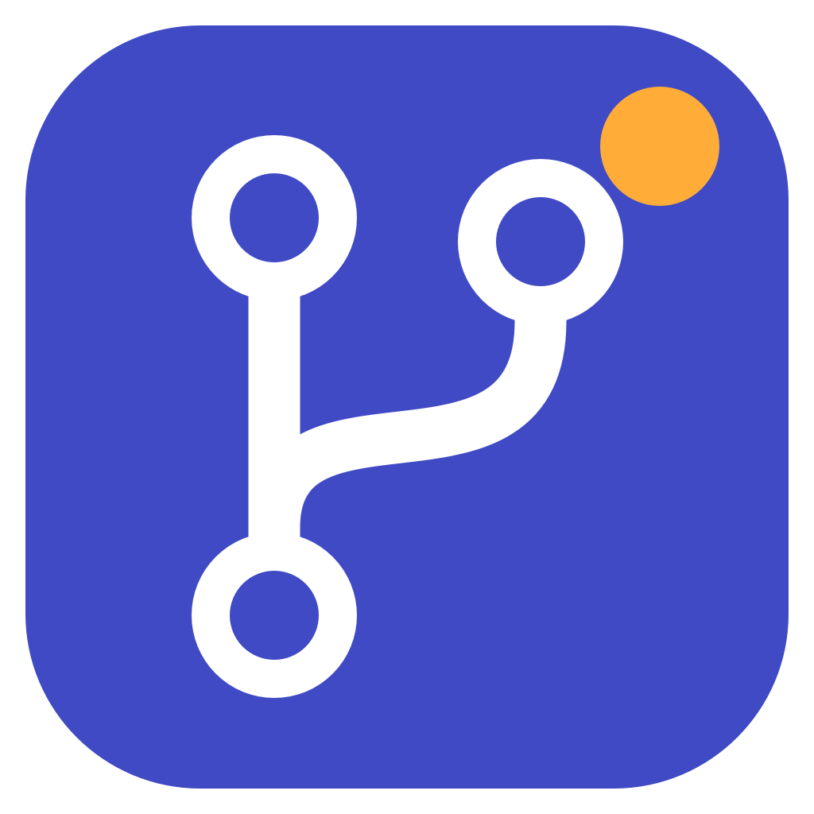

# GHNotif



[English](README.md) | **Polski**

Aplikacja w pasku menu macOS lub zasobniku systemowym Windows, która pokazuje otwarte (nie-draft) PR-y wybranych osób ze wszystkich repozytoriów widocznych dla Twojego tokenu GitHub. Obie wersje mają osobny, natywny interfejs.

## Instalacja macOS

**Homebrew (zalecane):**

```bash
brew tap MichalFidor/ghnotif
brew install --cask ghnotif
# aktualizacja:
brew upgrade --cask ghnotif
```

Gotowe paczki dla Apple Silicon i Intela są też w [GitHub Releases](https://github.com/MichalFidor/GHNotif/releases/latest).
Rozpakuj ZIP i przenieś `GHNotif.app` do Applications. Nie wymaga to instalacji Swifta.
Paczki Homebrew również nie są notaryzowane ani podpisane certyfikatem wydawcy — macOS może je zablokować
przy pierwszym uruchomieniu. Po zweryfikowaniu źródła i sumy SHA-256 użyj
Ustawienia systemowe → Prywatność i ochrona → Otwórz mimo to.

Budowanie ze źródeł:

```bash
./scripts/build-app.sh            # buduje build/GHNotif.app
./scripts/build-app.sh --install  # kopiuje do ~/Applications i uruchamia
```

Wymaga macOS 15+ i Swift 6 (wystarczą Command Line Tools). Autostart można włączyć w GHNotif → Ustawienia → Ogólne.

## Instalacja Windows

Wymaga Windows 10/11. Wersja portable zawiera .NET — użytkownik nie musi go instalować.

1. Pobierz ZIP `GHNotif-win-x64.zip` (typowy komputer) lub `GHNotif-win-arm64.zip` z [GitHub Releases](https://github.com/MichalFidor/GHNotif/releases/latest).
2. Rozpakuj cały ZIP do stałego folderu. Uruchom `GHNotif.Windows.exe`; plik `GHNotif.ico` musi pozostać obok.
3. Kliknij ikonę przy zegarku (może być schowana pod strzałką). Prawy przycisk: ustawienia, odświeżanie lub zakończenie.
4. Dodaj osoby w ustawieniach i użyj `gh auth login` lub zapisz własny PAT.

Aplikacja nie jest podpisana certyfikatem wydawcy; Windows SmartScreen może pokazać ostrzeżenie. Uruchamiaj wyłącznie buildy z zaufanego źródła.
Zamknięcie panelu ukrywa go w zasobniku. Autostart można włączyć w ustawieniach aplikacji.

Budowanie na Windowsie (wymagany .NET 10 SDK):

```powershell
./scripts/build-windows.ps1                    # build/GHNotif-win-x64.zip
./scripts/build-windows.ps1 -Runtime win-arm64 # build/GHNotif-win-arm64.zip
```

Wersja Windows ma jasny panel z grupowaniem po repo, awatarami, stanem review i CI, tooltipami, lokalnym odhaczaniem oraz powiadomieniami z zasobnika (ich widoczność zależy od ustawień Windows). Liczbę PR-ów widać w panelu i tooltipie ikony przy zegarku. Interfejs macOS korzysta z motywu systemowego.

## Autoryzacja

- Domyślnie używany jest token z `gh auth login` (aplikacja wywołuje `gh auth token`).
- Opcjonalnie w ustawieniach możesz zapisać PAT (Keychain). Ma pierwszeństwo przed `gh`.
- Na Windowsie PAT jest szyfrowany przez DPAPI dla bieżącego użytkownika; nie trafia do konfiguracji JSON. `gh` musi być dostępne w `PATH`; po jego instalacji uruchom GHNotif ponownie.
- Organizacje z SAML SSO: jeśli token nie jest dla nich autoryzowany, GitHub ukrywa ich PR-y. Aplikacja pokazuje wtedy ostrzeżenie z linkiem do autoryzacji.

## Konfiguracja

Ustawienia (ikona zębatki w nagłówku panelu) mają menu po lewej stronie (jak Ustawienia systemowe), a wybrana sekcja wyświetla się po prawej:

- **Osoby** – dodawanie obserwowanych osób (login jest weryfikowany w GitHub); lista jest domyślnie zwinięta, z licznikiem i filtrem. Można importować/eksportować listę JSON lub zaimportować członków zespołu GitHub (wymaga dostępu do członkostwa organizacji: `read:org` classic lub `Members: read` fine-grained).
- **Wyszukiwanie** – wzmianki i prośby o review (patrz niżej), dodatkowe kwalifikatory (np. `org:my-org`) oraz wykluczenia repozytoriów i etykiet.
- **Przypomnienia** – dni i godziny okna z przypomnieniem o review (patrz niżej).
- **Ogólne** – język, interwał odświeżania, powiadomienia, sortowanie, automatyczne odhaczanie po własnym review, autostart, wersja i aktualizacje.
- **Token** – źródło tokenu i opcjonalny PAT.

Nowa instalacja zaczyna z pustą listą osób.

## Wzmianki i prośby o review

Priorytetem są PR-y obserwowanych osób, ale lista może też zawierać:

- **wzmianki** (`mentions:@me`, domyślnie włączone) – otwarte PR-y dowolnych autorów, w których ktoś Cię wspomniał; oznaczone fioletowym `@`,
- **prośby o review** (`user-review-requested:@me`, domyślnie wyłączone) – tylko prośby skierowane do Ciebie osobiście, nie do Twojego zespołu; oznaczone ikoną osoby ze znakiem zapytania.

Wzmianki obejmują PR-y dowolnego autora (także Twoje). Dodatkowe kwalifikatory zakresu obowiązują w obu wyszukiwaniach. Po włączeniu opcji obecne PR-y nie wywołują powiadomień – tylko nowe.

Konfiguracja jest zapisywana w `~/Library/Application Support/GHNotif/config.json`.
Na Windowsie: `%LOCALAPPDATA%/GHNotif/config.json`, stan załatwionych, odłożonych i widzianych PR-ów oraz zwiniętych repozytoriów w `state.json`, zaszyfrowany PAT w `token.dat`. Nie dodawaj tych plików do repozytorium i nie udostępniaj tokenu.
Ustawienia obu platform są niezależne, bez synchronizacji.

## Załatwione PR-y

Przycisk z haczykiem po prawej stronie PR-a oznacza go jako załatwiony. PR znika z listy wymagającej uwagi i licznika. Nie wraca po odświeżeniu ani ponownym uruchomieniu, ale **wraca automatycznie (z powiadomieniem), gdy pojawi się nowa aktywność**:

- nowy commit (zmiana HEAD, także po force-pushu),
- nowy komentarz lub review od kogoś innego niż Ty (komentarze botów są pomijane).

Zmiana tytułu, etykiet czy samego statusu CI nie przywraca PR-a.

Powiadomienie pojawia się także przy nowej aktywności na PR-ze, który już jest na liście, i pokazuje, kto co zrobił, np. `anna — zatwierdzenie ✅`, `piotr — prośba o zmiany`, `bob — komentarz` albo `dave — nowe commity`. To samo zdarzenie nie jest ponawiane przy kolejnych odświeżeniach. Przy commitach widać autora ostatniego commita (GitHub API nie podaje, kto wykonał push). Nowy PR jest opisany jako „Nowy PR od …”, „Poproszono Cię o review” lub „Wspomniano Cię w PR-ze”.

Opcjonalnie PR jest automatycznie oznaczany jako załatwiony po wysłaniu przez Ciebie review bieżącego commita, o ile po tym review nie było nowej aktywności innych osób. Nowy commit lub komentarz/review innej osoby przywraca go na listę. Kolejne odświeżenia bez zmian nie powtarzają powiadomienia o tym samym komentarzu. Opcję można wyłączyć w ustawieniach.

## Odkładanie PR-ów i sortowanie

Zegar przy PR-ze odkłada go na 2 godziny albo do jutra rano. Odłożone PR-y są w osobnej liście i wracają po upływie czasu (z powiadomieniem, jeśli powiadomienia są włączone). Repozytoria można wykluczyć wpisując `owner/repo`, a etykiety po nazwie. Sortowanie: ostatnio aktualizowane, najstarsze lub największe zmiany. Przy PR-ze widać też liczbę dodanych/usuniętych linii, status CI i decyzję review.

Import/eksport listy obserwowanych przenosi wyłącznie loginy — nigdy token ani prywatne ustawienia. Import członków zespołu korzysta z endpointu GitHub do odczytu członków organizacji.

Przycisk z haczykiem w nagłówku przełącza na listę załatwionych, nadal otwartych PR-ów. Strzałka przy PR-ze przywraca go na główną listę. To wyłącznie lokalny stan aplikacji, nie review ani zamknięcie PR-a na GitHubie. Identyfikatory wraz z momentem odhaczenia i ostatnim commitem są przechowywane w preferencjach macOS lub pliku stanu Windows, poza repozytorium.

## Grupy repozytoriów

Kliknięcie nagłówka repozytorium zwija lub rozwija jego PR-y. Liczba po prawej to liczba PR-ów w tej grupie (na głównej liście: wymagających uwagi). Stan zwinięcia jest zapamiętywany między uruchomieniami. Po zwinięciu panel się zmniejsza: na macOS zostaje przyklejony do paska menu, na Windows do zasobnika.

## Przypomnienia o review

W ustawieniach, w zakładce **Przypomnienia**, można ustawić okno pokazywane na środku ekranu o stałych porach, np. codziennie o 9:00 w dni robocze. Okno zawiera aktualną listę PR-ów czekających na uwagę (pogrupowaną po repozytoriach) i pojawia się także wtedy, gdy lista jest pusta.

- Wybór dni tygodnia i dowolnej liczby godzin w ciągu dnia.
- Każda godzina ma własny przełącznik, jak budzik w iOS: można ją wyłączyć bez usuwania. Nowo dodana godzina jest od razu włączona.
- **Przypomnij za 15 min** odkłada okno; **Gotowe** zamyka je do następnej pory.
- Jeśli komputer spał lub aplikacja była wyłączona, pominięte przypomnienie z tego samego dnia pokaże się po wybudzeniu lub uruchomieniu (kilka pominiętych scala się w jedno).
- Zmiana harmonogramu nie wywołuje od razu przypomnień z godzin, które już minęły.

## Język

Interfejs jest dostępny po polsku i angielsku. W **Ustawienia → Ogólne → Język** wybierz *Systemowy* (polski, gdy pierwszym preferowanym językiem systemu jest polski; w przeciwnym razie angielski), *Polski* lub *English*. Nowe instalacje używają języka systemu, a istniejące konfiguracje bez tego ustawienia pozostają po polsku.

## Ikony i tooltipy

Najedź kursorem na ikonę, aby zobaczyć wyjaśnienie. Fioletowe `@` oznacza wzmiankę, ikona osoby ze znakiem zapytania – prośbę o Twoje review. Zielony haczyk oznacza zatwierdzone review, dymek/wykrzyknik — prośbę o zmiany, oko — wymagane review. Kropka CI: zielona = sukces, czerwona = błąd, żółta = w toku. Osobny haczyk na końcu wiersza oznacza PR jako lokalnie załatwiony.

Logo przedstawia rozgałęzienie PR z kropką powiadomienia. Kolorowe ikony aplikacji (`.icns`/`.ico`), logo do paska menu i jego wariant monochromatyczny są generowane ze wspólnego źródła:

```bash
swift scripts/generate-icons.swift # macOS
```

## Powiadomienia macOS

W ustawieniach aplikacji wybierz **Wyślij testowe powiadomienie**. Aplikacja poprosi
o zgodę i pokaże wynik wysłania oraz stan alertów. Przyjęcie powiadomienia przez API
nie gwarantuje wyświetlenia bannera: w Ustawienia systemowe → Powiadomienia → GHNotif
włącz banery/dźwięk i sprawdź tryb skupienia. Testy automatyczne sprawdzają, że nowy
PR i powrót odhaczonego PR-a wywołują powiadomienie; wygląd systemowego bannera
wymaga sprawdzenia na zalogowanym Macu.

## Wydania i aktualizacje

Numer wersji pochodzi z `VERSION`. Obie aplikacje sprawdzają najnowszy stabilny release
przy starcie i co 6 godzin; można też użyć **Sprawdź aktualizacje** w ustawieniach.
Gdy jest nowsza wersja, w panelu pojawia się przycisk otwierający GitHub Releases.
Sprawdzanie korzysta z publicznego API, bez tokenu i bez wysyłania listy obserwowanych osób.
Błędy sprawdzania są widoczne w ustawieniach i nie przerywają pobierania PR-ów.

Przy instalacji ZIP aktualizacja pozostaje ręczna. Homebrew: `brew upgrade --cask ghnotif`.
W obu przypadkach ustawienia, token i lokalny stan pozostają poza paczką.

Publikacja: zaktualizuj `VERSION` i `RELEASE-NOTES.md`, wypchnij commit i tag `vX.Y.Z`
zgodny z `VERSION`. Workflow **Release** uruchamia testy macOS/Windows, buduje cztery
paczki (macOS arm64/x86_64, Windows x64/arm64), a dopiero po powodzeniu publikuje
release z sumami `SHA256SUMS`. Sam build macOS ma podpis ad-hoc, bez notaryzacji.
Workflow dołącza też cask `ghnotif.rb` do release'u. Automatyczna synchronizacja tapu
w kolejnych wydaniach wymaga repozytorium variable `HOMEBREW_TAP_ENABLED=true` i secretu
`HOMEBREW_TAP_TOKEN` z prawem zapisu do `MichalFidor/homebrew-ghnotif`.

Publikacja działa w środowisku `release`, które wymaga akceptacji właściciela repo
(Actions → oczekujący run → **Review deployments**). Gałąź `main` i tagi `v*` są
chronione regułami. Ominąć je może tylko administrator repozytorium.

## Jak to działa

Zamiast jednego zapytania z `OR` (API wyszukiwania GitHub dopuszcza maks. 5 operatorów logicznych) autorzy są dzieleni na paczki po 10; powtórzone kwalifikatory `author:` działają jak OR. Każda paczka to zapytanie GraphQL `is:pr is:open draft:false author:… author:…`, wyniki są łączone i deduplikowane. Wzmianki i prośby o review to osobne zapytania; PR znaleziony kilkoma z nich ma wszystkie oznaczenia.

Na pasku menu macOS logo i licznik są rysowane jako jeden obraz, bo etykieta `MenuBarExtra` złożona z kilku widoków pokazuje tylko ich część.

## Testy

```bash
swift run CoreChecks
bash scripts/check-app.sh
```

Testy są zwykłym programem wykonywalnym, bo Command Line Tools nie zawierają XCTest ani makr Swift Testing.
Testy aplikacji sprawdzają ukrywanie, przywracanie, powrót PR-a po nowej aktywności, migrację starego stanu, zwijanie repozytoriów i trwałość stanu oraz powiadomienia. Działają z izolowaną konfiguracją i atrapami GitHuba oraz powiadomień.

Windows:

```powershell
dotnet run --project windows/GHNotif.Checks -c Release
dotnet run --project windows/GHNotif.Windows.Checks -c Release # tylko Windows
```

Testy rdzenia działają też na macOS/Linux: zapytania, paginacja, SSO, błędy API, konfiguracja, trwałość odhaczania, powrót po nowej aktywności, migrację stanu, przywracanie i powiadomienia. Testy Windows sprawdzają dodatkowo layout WPF, kliknięcia odhaczania/przywracania/zwijania, ustawienia i szyfrowanie DPAPI, bez prawdziwych tokenów i kont.
Workflow Windows buduje oba warianty portable i wykonuje te testy na runnerze Windows. Sam cross-build na Macu nie zastępuje testu interfejsu na Windowsie.
