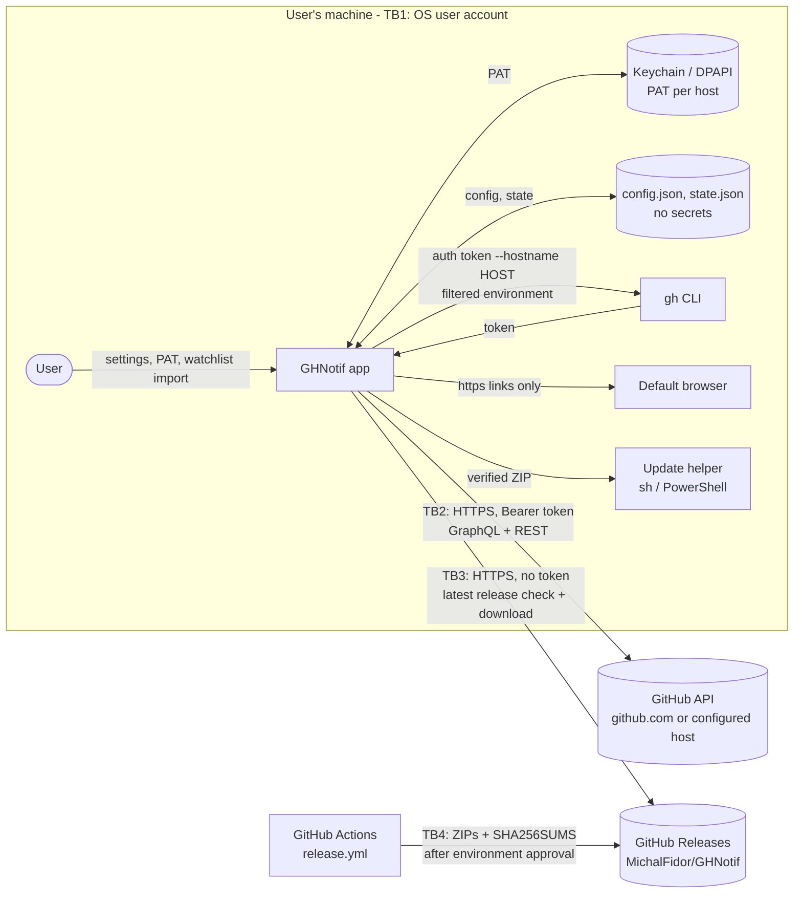

# GHNotif threat model

| | |
|---|---|
| Version covered | 0.7.6 (macOS menu bar app, Windows tray app) |
| Method | Data flow diagram + STRIDE per element and trust boundary |
| Last reviewed | 2026-11-02 |
| Inputs | Source code, release workflow, three independent code security reviews of 0.7.6 |

This document describes what GHNotif protects, who could attack it, where the trust boundaries are, which threats are mitigated in code and which risks are accepted. Code references point to the files that implement each mitigation.

## 1. System overview

GHNotif is a desktop app that shows open pull requests by people the user watches. It runs entirely on the user's machine as the logged-in user. There is no GHNotif server, no telemetry and no analytics. The app only reads from GitHub; it never writes to repositories.

| Component | macOS | Windows |
|---|---|---|
| UI and app logic | SwiftUI, `Sources/GHNotif` | WPF/.NET 10, `windows/GHNotif.Windows` |
| GitHub API client, models, validation | `Sources/GHNotifCore` | `windows/GHNotif.Core` |
| Saved PAT | Keychain, one item per host (`TokenProvider.swift`) | DPAPI (CurrentUser), one file per host in `%LOCALAPPDATA%\GHNotif` (`TokenStore.cs`) |
| Config and state (no secrets) | `~/Library/Application Support/GHNotif/*.json` | `%LOCALAPPDATA%\GHNotif\*.json` |
| Alternative token source | `gh auth token --hostname HOST` | same |
| Updates | ZIP from GitHub Releases or Homebrew cask (`UpdateInstaller.swift`) | ZIP from GitHub Releases + PowerShell helper (`App.xaml.cs`) |

External dependencies: none on macOS (Apple frameworks only). Windows uses one NuGet package, `Microsoft.Toolkit.Uwp.Notifications` 7.1.3 (toast notifications).

## 2. Assets

| ID | Asset | Why it matters |
|---|---|---|
| A1 | GitHub token (PAT or `gh` token) | Grants access to company repositories. With a classic `repo` token or a `gh` token it also grants **write** access. Highest-value asset. |
| A2 | Integrity of the installed app and the update channel | The app runs as the user and can read A1. A malicious build would compromise every user who updates. |
| A3 | PR metadata (titles, repositories, authors, review state) | Company-internal information. Shown in the UI and notifications; small parts (PR ids, commit author, read state) are cached in `state.json`. |
| A4 | Local configuration (GitHub host, watched logins, filters) | Controls where the token is sent and what is queried. |
| A5 | Release pipeline credentials | `GITHUB_TOKEN` with `contents: write` in the `publish` job, `HOMEBREW_TAP_TOKEN` for the Homebrew tap, the maintainer's GitHub account. |

## 3. Actors

| Actor | Capability | In scope |
|---|---|---|
| Network attacker | Observes or modifies traffic (public Wi-Fi, rogue proxy) | Yes |
| Malicious or compromised GitHub server | Controls responses from a host the user configured | Yes |
| Social engineer | Convinces a user to change the server, import a watchlist file or paste a token | Yes |
| Malicious PR author | Controls PR titles, branch names and other text returned by the API | Yes |
| Supply-chain attacker | Compromises the maintainer account, CI, a GitHub Action, the NuGet package or the Homebrew tap | Yes |
| Malware running as the same OS user | Reads the user's files, DPAPI data, keychain items the session can unlock, process memory | **No** - see accepted risk R1 |
| GitHub.com itself | | **No** - trusted |

## 4. Data flows and trust boundaries

| Boundary | Crossing | Main concern |
|---|---|---|
| TB1 | User input, imported files and local files into the app | Token storage, tampered config, malicious watchlist |
| TB2 | App to the GitHub API host (the token leaves the machine) | Token sent to the wrong host, MITM, malicious responses |
| TB3 | Releases into the app (code enters the machine) | Malicious or corrupted update |
| TB4 | Maintainer and CI into Releases | Supply chain compromise |

## 5. Threats and mitigations

Status: **Mitigated** - controls in code, low residual risk. **Partial** - reduced, residual risk described. **Accepted** - see section 6.

### TB2: token and API traffic

| ID | STRIDE | Threat | Mitigations | Status |
|---|---|---|---|---|
| T1 | Information disclosure | Token sent to a host it was not issued for: host changed while a request is in flight, cached token reused after a host change, redirect to another host | The token and its host travel together: `GitHubCredential` on Windows (`GitHubClient.cs`), `ResolvedToken.host` on macOS (`AppModel.swift`). The clients have no mutable "current host". Results for a host the user switched away from are dropped. macOS refuses redirects to another host (`GitHubClient.swift`); .NET drops the `Authorization` header on redirects. Regression tests cover the race on both platforms. | Mitigated |
| T2 | Information disclosure | `gh auth token --hostname HOST` returns `GH_ENTERPRISE_TOKEN` / `GH_TOKEN` from the environment for hosts they were not issued for | `gh` runs with those variables removed (`GitHubHost.gitHubCLIEnvironment`, `TokenStore.GitHubCliStartInfo`): for github.com the two enterprise variables, for every other host all four. | Mitigated |
| T3 | Spoofing | User is talked into setting an attacker-controlled "GitHub Enterprise" host | Only a plain host name is accepted (no port, credentials or path). A saved PAT is bound to the host it was saved for, so switching hosts never sends an existing PAT. `gh` only returns a token for a host the user logged in to. The settings text warns to enter only a trusted company address. Residual: a user who then pastes a github.com PAT for the attacker host gives it away. | Partial |
| T4 | Information disclosure, tampering | Network MITM | HTTPS only (macOS rejects non-https request URLs before sending; all endpoints are built as `https://`), OS certificate validation, no TLS bypass or custom trust. No certificate pinning (R4). | Mitigated |
| T5 | Elevation of privilege | Token with more rights than needed amplifies any leak | Settings recommend a read-only fine-grained PAT (Pull requests: read, Commit statuses: read, Members: read only for team import, 90-day expiry) with a prefilled link. The classic link asks only for `repo`. **Check connection** flags unneeded scopes. Residual: classic `repo` and `gh` tokens still carry write access (R3). | Partial |
| T6 | Information disclosure | Token leaks through logs, error messages, exports or config | The token is never written to `config.json`. The exported watchlist contains logins only. Logs contain only error descriptions. `GitHubCredential.ToString()` omits the token (tested). | Mitigated |
| T7 | Tampering | Malicious data in API responses (PR titles, URLs, avatars) | Text is rendered as plain text in native UI and notifications (no HTML or script engine). Only `https` links are opened; Windows also limits them to github.com and the configured host; the SSO link is https-only. Partial GraphQL errors are tolerated without trusting malformed data. | Mitigated |
| T8 | Denial of service | API rate limits, huge or malformed responses, slow host | Searches are batched (10 authors per query), the refresh interval is user-controlled, errors are shown instead of crashing, a corrupt config is reported instead of overwritten. | Mitigated |

### TB1: local storage and input

| ID | STRIDE | Threat | Mitigations | Status |
|---|---|---|---|---|
| T9 | Information disclosure | Token read from disk, another user account or backups | macOS: generic password in the login keychain, `kSecAttrAccessibleAfterFirstUnlock`, not synchronizable to iCloud. Windows: DPAPI CurrentUser, unreadable for other users and on other machines. Same-user malware is out of scope (R1). | Mitigated |
| T10 | Tampering | `config.json` edited to point to another host | A host that is not a plain host name falls back to github.com when loaded. Because the PAT is bound to its host, changing the host in the file does not send the saved PAT anywhere. Writing the file already requires same-user access (R1). | Mitigated |
| T11 | Tampering | Imported watchlist file (from a colleague or chat) with crafted "logins" | Logins are trimmed and de-duplicated but not validated against GitHub login syntax, so an entry like `x repo:foo/bar` adds a search qualifier. Impact is limited to which PRs are listed: queries are read-only, use the user's own token and go only to the configured host. See O4. | Partial |
| T12 | Elevation of privilege | Fake `gh` binary picked up from the working directory or a relative `PATH` entry | macOS uses fixed paths (`/opt/homebrew/bin`, `/usr/local/bin`, `/usr/bin`). Windows uses standard install folders and absolute `PATH` entries only. | Mitigated |

### TB3 and TB4: updates and supply chain

| ID | STRIDE | Threat | Mitigations | Status |
|---|---|---|---|---|
| T13 | Tampering | Update downloaded from another repository, host or tag | The release URL and every asset URL must be `https://github.com/MichalFidor/GHNotif/releases/...` and match the tag. Drafts and prereleases are ignored. The update check and download are unauthenticated (no token sent). | Mitigated |
| T14 | Tampering | Corrupted or truncated update | The SHA256 of the ZIP must match `SHA256SUMS`. macOS also checks the bundle id and that the bundle version equals the tag; Windows checks that the package contains `GHNotif.Windows.exe` and caps the download at 500 MB. Both installers restore the previous version on failure. | Mitigated |
| T15 | Tampering, elevation of privilege | **Malicious release** published through a compromised maintainer account or CI | `SHA256SUMS` is published in the same release, so it does not protect against this. Builds are not code-signed (macOS ad-hoc signature, Windows unsigned), so the OS cannot attribute the binary to a publisher. Controls in place: publishing needs approval in the `release` environment, the tag must match `VERSION`, CI runs all checks before building, and the workflow has `contents: read` by default with `write` only in `publish`. | **Accepted - highest residual risk** (R2) |
| T16 | Tampering | Compromised GitHub Action or NuGet package injects code at build time | Only GitHub-owned actions (`actions/checkout`, `setup-dotnet`, `upload-artifact`, `download-artifact`) and one Microsoft NuGet package are used. Actions are pinned to major tags, not commit SHAs. See O3. | Partial |
| T17 | Elevation of privilege | Update helper script or extracted files swapped in the temp folder between verification and install | Files live in a random per-update folder owned by the user; swapping them requires same-user access (R1). Arguments are passed positionally (macOS `sh -c` with `$1`..`$3`, Windows `ArgumentList`), never interpolated into script text. | Mitigated |
| T18 | Repudiation | No verifiable record of who built and published a release | GitHub records the tag push, the environment approval and the workflow run. O2 adds signed build provenance. | Partial |

## 6. Accepted risks

| ID | Risk | Rationale |
|---|---|---|
| R1 | Malware running as the same OS user can obtain the token (DPAPI CurrentUser, keychain access in the user session, process memory, `gh`'s own token store). | No desktop app can defend against code running with the user's privileges; `gh`, browsers and IDEs share this limitation. Endpoint protection is the control. |
| R2 | No code signing or notarization; checksums come from the same release. A compromised maintainer account or release pipeline can ship a malicious update that users install with one click. Gatekeeper and SmartScreen warn on first install. | Distribution is internal and signing certificates cost money. Reduced by environment approval and account security; O1, O2 and O5 reduce it further. |
| R3 | Classic `repo` tokens and `gh` tokens have write access to repositories. | GitHub has no read-only classic scope for private repositories. The read-only fine-grained PAT is recommended in the app and the docs. |
| R4 | No certificate pinning. | Pinning breaks corporate TLS inspection proxies and GHES with internal CAs. OS trust store validation is used instead. |
| R5 | The repository lives on a personal account. | Internal tool; see O5. |

## 7. Recommendations

Ordered by risk reduction per effort.

| ID | Recommendation | Reduces |
|---|---|---|
| O1 | Use a passkey or hardware key for 2FA on the maintainer account, keep the `release` environment restricted to required reviewers, protect `v*` tags with a tag ruleset. | T15, R2 |
| O2 | Add build provenance (`actions/attest-build-provenance`) and document `gh attestation verify` for manual installs; optionally verify it in the updater. Longer term: Developer ID signing + notarization and Authenticode. | T15, T18, R2 |
| O3 | Pin GitHub Actions to commit SHAs and enable Dependabot for `github-actions` and NuGet. | T16 |
| O4 | Validate watched logins against GitHub login syntax (allowing `[bot]` and EMU `_shortcode` suffixes) on input and import. | T11 |
| O5 | Move the repository to the company GitHub organization so access, audit log and secrets follow company policy. | R2, R5 |
| O6 | Users: prefer the read-only fine-grained PAT with an expiry; authorize SSO only for the organizations needed. | T5, R3 |

## 8. Review triggers

Update this document when any of these change: token sources or storage, the set of hosts the app talks to, the update mechanism, the release workflow, new dependencies, or features that write to GitHub.
